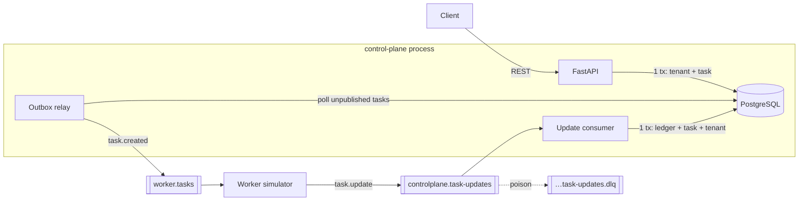

# Tenant Provisioning Control Plane

A multi-tenant SaaS control plane: a REST API that records tenants and emits provisioning tasks,
an idempotent consumer that applies worker progress, and a worker simulator.
Python 3.12 · FastAPI · PostgreSQL · RabbitMQ · Docker Compose.

## Quick start

Requires Docker (Compose v2) and `make`.

```bash
git clone <your-repo> && cd <your-repo>
make up        # builds & boots postgres, rabbitmq, api (+relay +consumer), worker
make test      # full automated suite (throwaway postgres + rabbitmq containers)
make check     # ALL quality gates: lint + format check + security scan + tests/coverage
```

`make up` generates a git-ignored `.env` with **random** local passwords (no secrets in the repo).
API: <http://localhost:8000> (interactive docs at `/docs`) · RabbitMQ UI: <http://localhost:15672>.

```bash
make format        # auto-format / auto-fix lint in your working tree
make load-test     # race-condition demo against the running stack (see below)
make logs          # follow api + worker logs
make clean         # stop, delete volumes and .env
```

### Try the lifecycle

```bash
curl -s -X POST localhost:8000/v1/tenants -H 'content-type: application/json' \
     -d '{"slug":"acme","name":"Acme Inc"}'
# 201 {"id":"…","slug":"acme","status":"provisioning","version":1,…,"task_id":"…"}

curl -s localhost:8000/v1/tenants/<id>          # → "active", version 2 after ~1-2 s
curl -s "localhost:8000/v1/tenants/<id>/tasks"  # deploy task: accepted → in_progress → done

curl -s -X PATCH localhost:8000/v1/tenants/<id> -H 'content-type: application/json' \
     -d '{"version":2,"name":"Acme Corp"}'      # 200, status "updating", creates an update task
curl -s -X DELETE localhost:8000/v1/tenants/<id> # 202, status "destroying", creates a destroy task
```

## Architecture



* **Write path.** Each mutating call is one DB transaction: change the tenant, insert the task.
  The task row *is* the event (its `id` is the event id). Nothing touches the broker in the request.
* **Outbox relay.** A background thread publishes committed tasks with `published_at IS NULL`
  (publisher confirms + `mandatory`) and then stamps `published_at`. It is woken right after each
  commit, and also polls, so events are not lost if the process dies after commit.
  Result: **never published before commit, never on rollback, at-least-once** (a crash between
  publish and stamp re-sends; consumers tolerate it).
* **Update consumer.** One transaction per update: lock the task row → insert `update_id` into
  an idempotency ledger (`ON CONFLICT DO NOTHING`) → apply the task transition → on a terminal
  outcome, lock and transition the tenant (bumping `version`). Ledger insert and state change commit atomically.
* **Worker simulator.** Separate process (`python -m worker_sim`); consumes tasks, publishes
  `in_progress` then `done`/`failed`. Update ids are deterministic (`<task_id>:<status>`).

### Wire format

| Direction | Exchange `controlplane` routing key / queue | Body |
|---|---|---|
| out | `task.created` → `worker.tasks` | `{id, type, tenant_id, status, created_at, updated_at}` (the task) |
| in | `task.update` → `controlplane.task-updates` (DLQ `…task-updates.dlq`) | `{update_id, task_id, status: in_progress\|done\|failed, error?, occurred_at?}` |

## API

| Method & path | Success | Notes |
|---|---|---|
| `POST /v1/tenants` | 201 + `Location` | body `{slug, name}`; creates `deploy` task |
| `GET /v1/tenants` | 200 | `?status=&limit=(1-200,50)&offset=` → `{items,total,limit,offset}` |
| `GET /v1/tenants/{id}` | 200 | |
| `PATCH /v1/tenants/{id}` | 200 | body `{version, name}`; only from `active`; creates `update` task |
| `DELETE /v1/tenants/{id}` | 202 | from `active`/`failed`; creates `destroy` task |
| `GET /v1/tenants/{id}/tasks` | 200 | filters `status`, `type` |
| `GET /v1/tasks` | 200 | filters `tenant_id`, `status`, `type`, `limit`, `offset` |
| `GET /v1/tasks/{id}` | 200 | tasks are read-only over HTTP |
| `GET /healthz`, `/readyz` | 200 | liveness / DB readiness |

Mutating responses return the tenant plus `task_id` of the task the call created. Timestamps are
ISO 8601 with milliseconds and `Z`. Lists are newest first.

### Errors

Always `{"error": {"code": "...", "message": "...", "details": {...}}}`.

| code | HTTP | when |
|---|---|---|
| `tenant_not_found` | 404 | unknown tenant id |
| `task_not_found` | 404 | unknown task id |
| `tenant_already_exists` | 409 | slug taken (also by `destroyed` tenants); exactly one concurrent creator wins |
| `tenant_version_conflict` | 409 | `version` ≠ current (`details.current_version`) |
| `tenant_update_not_allowed` | 409 | PATCH when not `active`; DELETE when not `active`/`failed` |
| `validation_error` | 422 | bad slug/name/body/query |
| `not_found` / `method_not_allowed` / `internal_error` | 404 / 405 / 500 | framework-level |

## Design decisions & trade-offs

* **Transactional outbox over "publish after commit" in the request.** Publishing inline after
  commit still loses the event if the process crashes in between. The outbox costs a poll thread
  and one extra column but makes the guarantee real. Publishing happens inside the relay's DB
  transaction (row locks held during the publish); fine at this scale, and `SKIP LOCKED` lets replicas share work.
* **Optimistic locking is one conditional `UPDATE … WHERE id AND version AND status`.** No
  read-then-write window; Postgres row locks serialise racers, losers re-evaluate the `WHERE` and
  match nothing. The failure branch then decides the error: version mismatch is reported first
  (so the loser of a same-version race gets `tenant_version_conflict`), else status → `tenant_update_not_allowed`.
* **One open task per tenant falls out of the status guards.** A partial unique index
  (`status IN ('accepted','in_progress')`) is kept as a belt-and-braces invariant, not as the mechanism.
* **Slug uniqueness = a UNIQUE constraint** over all rows, so destroyed slugs are never reused and
  concurrent creates are decided by the database.
* **Order tolerance.** Late/duplicate/contradictory updates are acknowledged and ignored, never errors.
  A *terminal* update that overtakes `in_progress` is applied (accepted → done) and the late
  `in_progress` is dropped. Dropping the terminal instead would strand the task, since the worker
  never re-sends it. If you prefer a strict machine, change `next_task_status` (one function).
* **Poison vs transient.** Unparsable, schema-invalid, unknown-task, or buggy-handler messages
  are dead-lettered (`nack requeue=false` → DLQ). DB/pool errors retry in-process with exponential
  backoff + jitter, then requeue (never lost). Broker connection loss reconnects with backoff.
* **Async logging.** Records are queued and written by a `QueueListener` thread as JSON lines, so
  slow stdout never blocks requests, the relay or the consumer.
* **Schema bootstrap with `create_all` under an advisory lock** instead of Alembic: simplest thing
  that works for a take-home. A real service would use migrations.
* **Offset pagination**: simple and predictable; keyset pagination would be better for very large tables.
* **Known gaps (deliberate):** no authN/Z; the ledger table (`processed_updates`) has no retention
  job; no metrics/tracing; DELETE has no version precondition (state guard only); no lockfile pinned.

## Negative scenarios

**Failures / delays** — restart the worker with different parameters (CLI args or env vars):

```bash
WORKER_FAIL_RATE=1 docker compose up -d worker          # every task ends `failed`
docker compose stop worker
docker compose run --rm worker --fail-rate=1 --min-delay-ms=100 --max-delay-ms=300
docker compose run --rm worker --duplicate-rate=1       # every update sent twice
docker compose run --rm worker --out-of-order-rate=1    # terminal update sent BEFORE in_progress
docker compose run --rm worker --help
```

Then `POST` a tenant and watch it end `failed` (`GET /v1/tasks?status=failed`), or converge to
`active` despite duplicates/reordering (version stays 2). Restore with `docker compose up -d worker`.

**Publish messages directly** (stop the worker first so it does not race you):

```bash
docker compose stop worker
TASK=<task id>
docker compose exec api python -m controlplane.tools.publish_update --task-id $TASK --status done
docker compose exec api python -m controlplane.tools.publish_update --task-id $TASK --status in_progress  # stale: ignored
docker compose exec api python -m controlplane.tools.publish_update --task-id $TASK --status done \
     --update-id fixed-key --repeat 3                      # idempotent: applied at most once
docker compose exec api python -m controlplane.tools.publish_update --raw 'not json'  # poison → DLQ
# inspect the DLQ in the RabbitMQ UI (queue controlplane.task-updates.dlq) or:
docker compose exec rabbitmq rabbitmqctl list_queues name messages
```

**Race conditions over real HTTP** (worker running, `fail-rate=0`):

```bash
make load-test
# PASS  20 concurrent creates of 'load-…': {201: 1, 409: 19}
# PASS  20 concurrent PATCHes with version=2: {200: 1, 409: 19}
# PASS  20 concurrent DELETEs: {202: 1, 409: 19}
```

## Quality gates

`make check` runs, inside a container: `ruff check` (lint), `ruff format --check` (formatter),
`bandit` (security scan), and `pytest` with coverage (gate: 65%). The suite covers the state
machine (pure, table-driven), HTTP contract and error mapping, **real-thread concurrency against
PostgreSQL** (same-slug creates, same-version PATCHes, PATCH-vs-DELETE, concurrent duplicate
updates), outbox behaviour (after-commit, rollback, outage, partial failure), consumer
dispositions (poison, transient, redelivery), the worker simulator, JSON logging, and an
end-to-end test through a real RabbitMQ. CI: `.github/workflows/ci.yml` runs `make check`.

> First run: run `make format` once, then `make check`, so the formatter's verdict matches your
> installed ruff version.

## Layout

```
src/controlplane/   api/ (FastAPI, routes, wiring) · services/ (tenants, tasks, updates)
                    messaging/ (topology, publisher, relay, consumer) · state.py · models.py …
src/worker_sim/     worker simulator CLI
tests/              unit, DB-backed, concurrency, e2e
deploy/k8s/         illustrative Kubernetes manifests
```

## Production notes (mapping to AWS / platform stack)

The code runs locally by design; the seams for production are small.

* **Broker:** `EventPublisher` is a protocol and `UpdateConsumer.process()` is transport-agnostic, so
  RabbitMQ can be swapped for SNS→SQS (fan-out topic, queue per consumer, DLQ via redrive policy,
  `MessageDeduplicationId` = task/update id on FIFO) without touching the domain code.
* **Database:** point `DATABASE_URL` at Aurora PostgreSQL (writer endpoint); all concurrency
  control is plain row-level locking and a conditional UPDATE.
* **Secrets:** inject `DATABASE_URL` / `AMQP_URL` from AWS Secrets Manager (ECS `secrets`, or External Secrets / CSI driver on EKS). Nothing is read from files.
* **Identity:** run under an IAM role (IRSA on EKS / task role on ECS) for SQS/SNS/Secrets Manager access.
* **Logs/metrics:** stdout JSON → CloudWatch Logs (awslogs driver / Fluent Bit); health endpoints
  for ALB/Kubernetes probes.
* **Edge:** terminate OAuth2/OIDC (JWT validation, SAML federation at the IdP) and rate-limit at
  an API gateway (API Gateway / Kong / Apigee); mTLS between services via Istio/Envoy. The service
  itself is deliberately auth-free to keep the scope on state, concurrency and messaging.
* **Scaling:** stateless API; multiple replicas are safe (outbox `SKIP LOCKED`, idempotent consumers).
  See `deploy/k8s/controlplane.yaml`.
