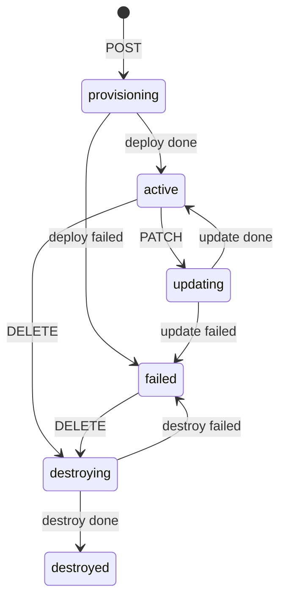

# Data Model

## tenants
| column | type | notes |
|---|---|---|
| id | varchar(36) PK | uuid4 |
| slug | varchar(28) UNIQUE NOT NULL | unique over **all** rows incl. destroyed |
| name | text NOT NULL | non-empty (validated) |
| status | varchar(16) NOT NULL, indexed | provisioning, active, updating, destroying, destroyed, failed |
| version | int NOT NULL | starts 1, +1 on every mutation (API or worker-applied) |
| created_at / updated_at | timestamptz NOT NULL | ms precision |

## tasks (also the transactional outbox)
| column | type | notes |
|---|---|---|
| id | varchar(36) PK | doubles as event id |
| type | varchar(16) | deploy, update, destroy |
| tenant_id | FK → tenants.id | |
| status | varchar(16) | accepted, in_progress, done, failed |
| error | text NULL | set on failure |
| created_at / updated_at | timestamptz | |
| published_at | timestamptz NULL | NULL = not yet handed to the broker |

Indexes: partial UNIQUE `(tenant_id) WHERE status IN ('accepted','in_progress')` (one open task
per tenant, safety net); partial `(created_at) WHERE published_at IS NULL` (relay scan);
`(tenant_id, created_at)`.

## processed_updates (idempotency ledger)
`update_id` varchar(128) PK · `task_id` · `outcome` (applied|stale) · `received_at`.

## State machines

Task: `accepted → in_progress → done|failed` (plus tolerated `accepted → done|failed`, see spec clarification 2).

## Invariants
1. ≤1 open task per tenant. 2. `version` strictly increases. 3. Terminal tasks never change.
4. A tenant only leaves `provisioning/updating/destroying` via its matching task's terminal outcome.
